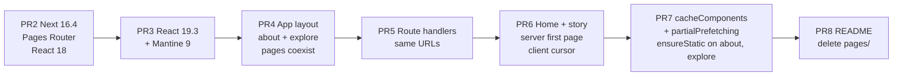
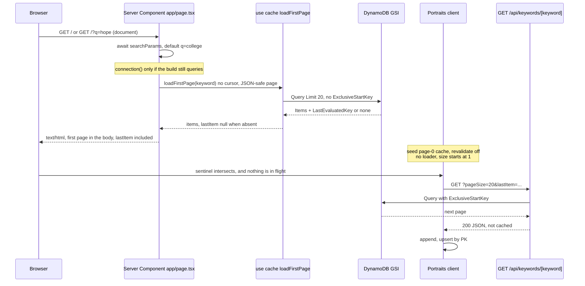
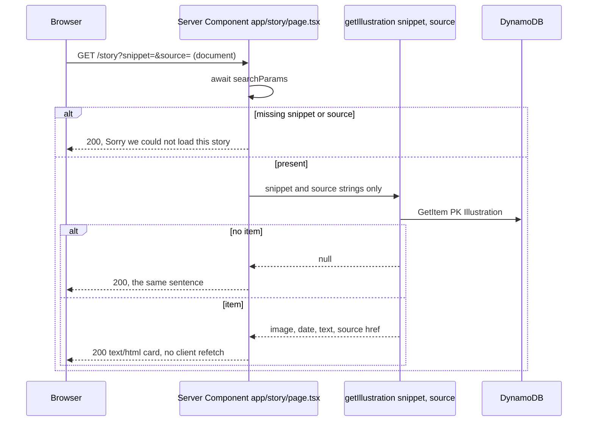

# Convey migration plan: Next.js 14 (Pages Router) → Next.js 16.4

| | |
| --- | --- |
| Author | Brad Bissell |
| Date | 2026-10-08 |
| Status | Draft |
| Repo | https://github.com/BradBissell/Convey.git |
| Branch this plan lands on | `docs/next-16.4-migration-plan` |
| Implementation branch | `migrate/next-16.4` (cut from `main` after this plan is accepted; not created by this task) |
| Live demo | https://illustration-finder-hony.vercel.app/ |
| Target | `next@16.4.0`, `react@19.3.0`, `react-dom@19.3.0`, Mantine `9.7.1` |

This is a planning document. It does not change application source.

## Overview

Convey is a Pages Router app on `next@^14.2.0` and React 18.2.0. The home page is fully static: `pages/index.tsx` keeps the keyword in `useState('college')` and `components/Portraits.tsx` loads every page, including the first, in the browser with `useSWRInfinite`. That shape is deliberate. Commit `a62e9f7` (2026-06-04, PR #15) removed `getStaticProps` because Vercel was serving `/` as a raw multipart RSC body.

The end state is Next.js 16.4.0 on the App Router, still Yarn, still Node `24.x`. The first page of keyword results is rendered by a Server Component and passed into the existing client list. The client keeps the cursor, the in-flight guard, and load-more. Story detail does not follow that split: the Server Component renders the card and does not mount SWR. `/about` and `/explore` become static App Router routes. Cache Components (`cacheComponents` and `partialPrefetching`) turn on only after those routes exist, in their own PR, which is the model 16.4 recommends and that 17 will default. DynamoDB stays a single-table Query/GetItem. The 7,491 JPEGs under `public/portraits` stay where they are.

Production UI at work is Vue and Nuxt. This plan is the Next app Brad can narrate. It is not a mail client, and it does not invent mail traffic numbers.

## Background and motivation

### Current stack (verified from the repo)

`package.json` and the tree:

- `next@^14.2.0`, `react` and `react-dom` pinned to `18.2.0`, TypeScript `^5`, `engines.node` `24.x`, `.nvmrc` `24`. Package manager is Yarn 1.22.19 (`yarn.lock` v1).
- Scripts: `next dev`, `next build`, `next start`, `lint` = `next lint`. ESLint `8.29.0` with `eslint-config-next@^14.2.0` and `.eslintrc.json` extending `next/core-web-vitals`.
- Mantine `5.9.5`: `@mantine/core`, `@mantine/hooks`, `@mantine/next`. Emotion 11 (`@emotion/react`, `@emotion/server`).
- Data: SWR `^2.4.1`, AWS SDK v3 DynamoDB (`lib/ddbDocClient.ts`, `lib/loadIllustrations.ts`).
- Graph: `sigma@^2.4.0`, `graphology`, `@react-sigma/*@^3.1.0`. `/explore` dynamic-imports `components/GraphController.tsx`. That file's `LayoutForceAtlas2Control` is what constructs the blob worker (`useWorkerLayoutForceAtlas2` inside `@react-sigma/layout-forceatlas2`). `components/ForceAtlasGraph.tsx` also calls the hook and nothing imports it. It is not on the live path.
- Tests: Jest 29 via `next/jest` (`jest.config.js`), Testing Library, MSW `0.49.2`, `next-router-mock`. Cypress `^12.3.0` covers `cypress/e2e/home.cy.ts` and `about.cy.ts` only.
- CI (`.github/workflows/ci.yml`): on push to `main` and on pull requests, `ubuntu-latest`, Node from `.nvmrc`, `yarn install --frozen-lockfile`, `yarn lint`, `yarn test --ci`, `yarn build`. No AWS credentials in CI.

There is no `app/` directory and no `middleware` file. `next.config.js` sets `reactStrictMode`, `swcMinify: true`, `poweredByHeader: false`, and security headers on `/:path*` (CSP including `worker-src 'self' blob:` and `child-src 'self' blob:`, HSTS, `X-Frame-Options: DENY`, nosniff, referrer, permissions policy).

### Routes today

| Route | File | Data |
| --- | --- | --- |
| `/` | `pages/index.tsx` | Static. No `getStaticProps`. Keyword defaults to `college` in React state. |
| `/about` | `pages/about.tsx` | Static copy. |
| `/explore` | `pages/explore.tsx` | Client-only Sigma graph. `next/dynamic(..., { ssr: false })` is called during render, and the page returns "Not Available" when `window` is undefined. Both of those move incorrectly if copied into a client component as-is. See the explore sketch. |
| `/story` | `pages/story.tsx` | Client `useSWR` against `/api/illustrations/get`. Query comes from `next/router`. |
| `GET /api/keywords/[keyword]` | `pages/api/keywords/[keyword].ts` | `loadByKeyword`. Cursor query param `lastItem`. |
| `GET /api/illustrations/get` | `pages/api/illustrations/get.ts` | `GetCommand` on `PK = Illustration#<snippet>`, `SK = Meta#<source>`. |

`pages/_app.tsx` mounts `MantineProvider` (`withGlobalStyles`, `withNormalizeCSS`, `colorScheme: 'light'`, heading weight 300), global `<Head>`, `LayoutDefault`, and optionally MSW when `NEXT_PUBLIC_API_MOCKING=enabled`. `pages/_document.tsx` uses `createGetInitialProps` from `@mantine/next`.

### What hurts

1. The first page of results is a client fetch, so the first paint is `LoadingCircle` (`data-testid="loader"` in `Portraits.tsx`). The interview-relevant shape is the opposite: the server sends the first page, the client owns the cursor.
2. The previous attempt to do that (`getStaticProps` + SWR `fallback`) took down `/` on Vercel. Any new design that prerenders `/` at build time reintroduces that class of failure and a build-time DynamoDB dependency CI cannot satisfy.
3. Next 16 removes `next lint` and `swcMinify`. Staying on 14 means those breaks arrive later, under a time constraint, instead of in a reviewed sequence.
4. Mantine 5's styling path (`createStyles`, `@mantine/next`, Emotion SSR in `_document`) does not survive an App Router layout. Mantine 9 is the current major that declares React 19.2 support.

The README architecture section still describes "Next.js 14 (pages router), React 18". Those claims change in the last PR. This task does not edit the README.

## Goals and non-goals

### Goals

- Ship `next@16.4.0` and React 19.3 on the App Router, Yarn, Node `24.x`.
- Home: the document response for `/` and `/?q=<keyword>` includes the first page of illustrations. No client loading flash before that page. The client owns cursor, in-flight status, and load-more.
- Preserve API status codes, the `Allow: GET` header, query validation, the clamped page size, and "log the detail, return a generic 500".
- Keep the DynamoDB key shapes and the public image URLs.
- Keep `/explore` working, including the blob worker under the current CSP.
- Each PR is reviewable on its own. `yarn build` in GitHub Actions must not call DynamoDB.
- Leave `main` and the live demo on the current app until `migrate/next-16.4` is ready to merge.

### Non-goals

- Redesigning the DynamoDB single-table model or the offline NLP indexing pipeline.
- Moving `public/portraits` (about 7,491 JPEGs). `NEXT_PUBLIC_IMAGE_BASE_URL` already exists (`lib/imageUrl.ts`).
- Rewriting the Sigma / Graphology graph, including a jump to `sigma@3` / `@react-sigma/core@5`.
- React Compiler, `experimental.agentUpgrade`, `experimental.agentFeedback`, `experimental.turbopackPluginRuntimeStrategy`.
- Turning Convey into a mail UI. No auth, accounts, or personalization.
- A visual redesign beyond what Mantine 9 requires for parity.
- Edge runtime. Cache Components require the Node.js runtime. Vercel serverless Node is the target.
- A feature-flag service. None exists. Do not add one.
- Tightening CSP to a nonce. Re-verify the existing policy; do not rewrite it.

## Key decisions

### 1. Full App Router cutover, incrementally, not a Pages-only bump

Stay-on-Pages was rejected. Next 16.4 still supports the Pages Router (the docs still describe it as supported, and `next@16.4.0` does not remove `pages/`). A version bump alone does not produce a server-rendered first page, which is the behavior this migration exists to make narratable. Pages `getStaticProps` is also the API that broke `/`.

A big-bang rewrite was rejected. The App Router migration guide still says `app/` and `pages/` coexist, and that `app/layout.tsx` styles do not apply to `pages/*`. Coexistence is how the middle PRs stay reviewable.

End state is App Router only. Coexistence is a transition, not the destination. Delete `pages/` in the last PR.

Cache Components turn on in the PR after home and story have moved, not in the version-bump PR. The 16.4 post recommends the pair `cacheComponents: true` and `partialPrefetching: true`, and says both become default in 17. The version 16 upgrade guide says not to enable `cacheComponents` merely to finish the upgrade. `partialPrefetching` left unset logs a warning once `cacheComponents` is on; set both in the same later PR.

### 2. React 18 stays for the Next bump, then leaves with Mantine

`npm view next@16.4.0` on 2026-10-08:

- `version`: `16.4.0`
- `engines.node`: `>=20.9.0`
- `peerDependencies.react` / `react-dom`: `^18.2.0 || 19.0.0-rc-de68d2f4-20241204 || ^19.0.0`

So React 18.2.0 still installs. The version 15 upgrade guide says the minimum React is 19. That sentence disagrees with the 16.4.0 manifest. The manifest wins for "will Yarn install it." The support policy wins for "should we stay there."

Confirmed support policy, which the 16.4 announcement blog and the version 16 upgrade guide do not themselves state:

- The 16.4.0 GitHub release notes include "Pages Router: Deprecate React 18 support" (`#97689`).
- https://nextjs.org/docs/messages/react-version (docs version 16.4.0) says React older than 18.2 is unsupported, React 18.2 and later remain supported in Next.js 16 but React 18 is deprecated, and React 19 is recommended and will be required in Next.js 17.
- The App Router uses the React canary shipped with Next. 16.4 ships React 19.3 (https://nextjs.org/blog/next-16-4, https://react.dev/blog/2026/09/09/react-19-3). The Pages Router uses the React version in `package.json`.

`react@19.3.0` exists. `react-dom@19.3.0` peers `react@^19.3.0`.

Decision: the version-bump PR stays on React 18.2.0 so Mantine 5 still renders and the Pages app boots. The next PR installs React 19.3.0 and Mantine 9.7.1 together, in one commit. A first commit that is React 19 on Mantine 5 would be the tree this decision forbids, and bisect or a per-commit preview would stop there. Mantine 9.7.1 peers `react@^19.2.0` and `react-dom@^19.2.0`. Mantine 8.3.18 peers `^18.x || ^19.x`, but it is not the latest major. There is no point landing 8 and then 9.

`@mantine/core@5.9.5` peers `react >=16.8.0`, not React 18 only. Yarn will install React 19 against Mantine 5. That is not evidence Mantine 5 runs on React 19. Mantine's own changelog says v7 is the React 18 line and v9 requires React 19.2. Do not merge a React 19 tree that is still on Mantine 5.

Node stays `24.x`. Next does not require a narrower range. The 16.4 post's Node bug (worker threads fall back to child processes on Node 24.13.1+, https://github.com/nodejs/node/issues/65100) matters only if `experimental.turbopackPluginRuntimeStrategy: 'workerThreads'` is set. This migration does not set it. Local Node is v24.16.0, which is inside that bug's range, and that is fine while the flag stays off.

### 3. The keyword moves to `?q=`

Today the keyword is `useState('college')` in `pages/index.tsx`. It is not in the URL, so the server cannot know it on a shared link, and a server render can only ever prefetch `college`.

Decision: `q` is the keyword. Absent or empty `q` means `college`, so `/` is unchanged for the default search. Choosing a chip calls `router.replace('/?q=' + encodeURIComponent(keyword))` (and `/?q=college` may be written explicitly; do not invent a second param). The Server Component reads `searchParams.q`, loads the first page, and passes it to the client list.

Alternative, rejected as the default: server-render only `college` and keep later keywords in client state. That is a smaller diff and avoids `searchParams`, but a shared "hope" link still paints `college` and then swaps. The search param is the one that matches "the first page for this query came from the server."

Do not put the cursor in the URL. `lastItem` is a DynamoDB `ExclusiveStartKey`. It stays a client SWR key and a query param on the load-more request only.

### 4. Keep SWR `useSWRInfinite`

Replacing SWR with a hand-rolled `useRef` request id would duplicate what SWR already does and would be a larger client, not a smaller one. SWR `^2.4.1` already peers React 19 (`swr@2.3.0` added `^19.0.0`; `2.5.1` is the latest 2.x and still does). Keep the dependency.

SWR does not cover every rule below. The component does. Those gaps are fixed in the home PR, not by a new library.

`fallbackData: [firstPage]` is still required, and it is not sufficient. The installed `swr/infinite` (`node_modules/swr/infinite/dist/index.mjs`) never reads `fallbackData`. It forwards `config` to core `useSWR`, and core uses `fallbackData` only as `data` when the `$inf$` cache entry is empty (`node_modules/swr/core/dist/index.js`). That skips `LoadingCircle` on first paint. It does not write page 0 into the per-page cache that `getKey` and `setSize` consult. `setSize` loads each page with `getCache().data` for that page's key, and if that entry is missing it calls `mutate` on the infinite cache, which refetches page 0 before it can request page 1. Defaults make this worse: `revalidateFirstPage` is `true` in that file, and core revalidates on mount when `revalidateOnMount` is unset and `revalidateIfStale` is left at its default.

The hook options are therefore:

```ts
useSWRInfinite(getKey, fetcher, {
  fallbackData: [firstPage],
  revalidateOnMount: false,
  revalidateIfStale: false,
  revalidateFirstPage: false,
});
```

`parallel` stays at its default, `false`. Before the hook runs, seed the page-0 key synchronously. Not in an effect. The function is `useSWRConfig().mutate` from `'swr'`, with `{ revalidate: false }`.

```tsx
const { mutate } = useSWRConfig();
const page0Key = `/api/keywords/${keyword}?pageSize=${PAGE_SIZE}`;
mutate(page0Key, firstPage, { revalidate: false });
```

Do not import `mutate` from `'swr'`. That export is `initCache(new Map())` in `node_modules/swr/_internal/dist/index.mjs` (the default cache). `useSWRInfinite` reads `config.cache` from context. `__tests__/Portraits.test.jsx` wraps every render in `<SWRConfig value={{ dedupingInterval: 0, provider: () => new Map() }}>`, and that provider replaces `config.cache` and `config.mutate` (`SWRConfig` assigns `extendedConfig.cache` and `extendedConfig.mutate` from `initCache`). `setSize` then calls `createCacheHelper` on that Map. A write to the default cache leaves the test Map empty, so `setSize(2)` takes the missing-page branch and refetches page 0. There is no `SWRConfig` in the app, so the default `mutate` would appear to work in the browser and fail in the harness this plan keeps. `useSWRConfig` is re-exported from `swr/_internal`, the same module the test imports `SWRConfig` from, so the two share a context. Do not call the `mutate` returned by `useSWRInfinite` for this seed. That one writes the `$inf$` key, which `setSize` does not read. The error-retry `mutate()` later in this section is that infinite-hook function, with no data argument, and it is a different call.

Seeding only the `$inf$` entry does not satisfy `setSize`. An effect is too late: the sentinel fires `setSize` 100ms after it intersects, and a test can call `setSize` immediately. Keep the existing `provider: () => new Map()` wrapper on the new Portraits tests so the assertion reads the cache the seed wrote. Do not revive the old `SWRConfig fallback` map. That map was keyed `/api/keywords/college` while the client key is `/api/keywords/college?pageSize=20`, so it did not match, and it was the prop that got embedded in the bad prerender.

### 5. `ensureStatic` is only for `/about` and `/explore`

`ensureStatic` shipped in 16.4. It works only when `cacheComponents` is on, and only from a Server Component page or layout. `'navigation'` fails the build if the route reads `searchParams`, `cookies()`, `headers()`, `connection()`, or uncached data, even inside `<Suspense>`, or if a `use cache` profile is shorter than the documented floors (expire under five minutes, stale under 30 seconds, or revalidate `0`).

`/` and `/story` read `searchParams` and DynamoDB on purpose. `ensureStatic = 'navigation'` on either route fails the build, or forces the data out of the document. Do not put it there. Do not put it on the root layout, or it would apply to every route.

`/about` is static copy. `/explore`'s server page renders a client graph and does not read the request. Both get `export const ensureStatic = 'navigation'` in the Cache Components PR, in the same commit as the two flags and as `instant = false` on `/` and `/story`.

### 8. Story is a server-rendered card, HTTP 200, no client refetch

`pages/story.tsx` does not render the API's JSON errors. Missing `snippet` or `source` sets the SWR key to `null`, so the page stays on `LoadingCircle`. The fetcher does not check `res.ok`, so a 404 body `{ error: 'Illustration not found' }` becomes `data` and the page then reads `data.SK`. The only sentence in the file is the SWR throw path: "Sorry, we couldn't load this story."

The App Router page does not return HTTP 400. There is no `middleware` or `proxy`, and this plan does not add one. `notFound()` would be a 404 document this page has never sent.

Decision: `app/story/page.tsx` is a Server Component. It awaits `searchParams`. If `snippet` or `source` is missing, or the item is missing, it renders that same sentence inside the existing `Container` and the document is status 200. If the item exists, it renders the same card (image, date, text, Source button). It does not mount SWR, does not refetch, and has no cursor. The Source href stays `https://` plus `SK.slice(13)`, computed on the server. The raw `GetItem` result is not passed to a Client Component: `keywords` and `entities` are typed as `Set`, which the RSC boundary will not serialize. The server reads `image`, `date`, `text`, and `SK` and passes strings only.

### 9. No Suspense shell on `/` or `/story`

The home page does not import `Suspense` and does not wrap the list. `instant = false` is the opt-out from instant-navigation validation once Cache Components are on. A Suspense fallback would be the static shell a non-streaming client can observe, and this page's requirement is that the completed document contains the rows. If the Cache Components build still refuses the route, the postpone is `await connection()` in the page before the cached call (decision in the caching section), not a loader document.

### 6. Implementation PRs merge into `migrate/next-16.4`, then one merge to `main`

One-by-one onto `main` was rejected. There is no flag service, and the live demo has to keep serving the current app. Intermediate states (Mantine 9 still on Pages, or App Router without home) are not the production UI.

Vercel preview deployments of the long-lived branch, and of each PR into it, are the staging environment. Rollback of a PR on that branch is revert. Rollback of the final merge is revert plus the previous Vercel deployment.

No env flag. Do not add `NEXT_PUBLIC_NEW_HOME` or similar.

### 7. CSS modules, not `@mantine/emotion`

`@mantine/emotion@9.7.1` exists and still exports `createStyles`, and it peers React `^19.2.0`. It was rejected. Mantine 7 dropped Emotion because CSS-in-JS SSR is a poor fit for the App Router, which is the layout this app is moving to. The `createStyles` surface is six files. Port them to CSS modules.

## The `/` RSC body failure, and how the new model avoids it

`git log -S getStaticProps -- pages/index.tsx` shows two relevant commits.

`bd2c77f` ("added SWR fallback from SSR", 2023-01-07) added `getStaticProps`. It called `loadByKeyword(undefined, 'college', undefined)` at build time and returned:

```ts
fallback: {
  '/api/keywords/college': JSON.parse(JSON.stringify(illustrations)),
}
```

The `JSON.parse(JSON.stringify(...))` existed because `undefined` values in the DynamoDB result cannot be serialized as Next props. That conversion is still required. A short page (Cypress's `hope` query is 18 rows, under `PAGE_SIZE` 20) has `LastEvaluatedKey === undefined`. React will not serialize `undefined` inside a prop object passed to a Client Component, so `/?q=hope` 500s if `loadFirstPage` returns the raw `QueryCommand` output. Coerce `lastItem` to `null` before `JSON.stringify`, because `JSON.stringify({ lastItem: undefined })` drops the key and the parsed object has `lastItem` undefined again. `null` is what the client stop condition treats as "no more pages." Keyword rows in `mocks/collegeKeyword.ts` are plain objects, so the sure break is the missing cursor, not `keywords: Set` on the meta item. The normalization still strips any nested `undefined` the SDK leaves on an item. Do not pass a `Set`, the Dynamo client, or the raw command output across the boundary.

`a62e9f7` (2026-06-04, the second commit inside "chore: pin Node.js to 24.x for Vercel builds (#15)") removed that function. The message says: after the Next 13.5.11 upgrade, `/` was the only `getStaticProps` page, and Vercel served it as a raw multipart "prerender variant" body (`Vary: RSC, Next-Url`) instead of HTML. Every page without `getStaticProps` served HTML. The fix made `/` a plain static page like `/about`, and removed the build-time DynamoDB call. The comment now in `pages/index.tsx` matches that message.

What the new model does instead:

- No `getStaticProps`, no `getServerSideProps`, no SSG prerender variant for `/`.
- A Server Component awaits the first page at request time and renders it into the document. A browser navigation sends `Accept: text/html` and must receive `Content-Type: text/html` with `<!DOCTYPE html>`. The RSC flight payload is a separate response for a client navigation that asks for it (`RSC: 1` / `Accept: text/x-component`). That second response is allowed to be a flight body. The bug was the flight body being served as the document.
- The page reads `searchParams`, so before Cache Components it is dynamic and `next build` does not execute the DynamoDB call. CI has no AWS credentials. This is a hard constraint.
- Do not add `app/loading.tsx`. On a client navigation the previous UI stays up until the new server render commits, and that render already includes the first page, so the list does not pass through `LoadingCircle`.
- `ensureStatic` is the wrong tool here. It would demand a fully static navigation, which this route is not. Naming it in a review comment is not a reason to export it.

Verification on every preview that moves `/`:

```bash
curl -sI "https://<preview>/" | tr -d '\r' | grep -i -E 'HTTP/|content-type|vary'
curl -s "https://<preview>/" | head -c 200
```

Pass: status 200, `content-type` contains `text/html`, body starts with `<!DOCTYPE html>` (or `<html`), and the first screen of results is in that body. Fail: `multipart/mixed`, `text/x-component`, or a body that is an RSC flight (`0:`, `1:`, `vary: rsc`). Repeat for `/?q=hope` once the param exists.

## Infinite list: current behavior and the contract to keep

`components/Portraits.tsx` today:

- `PAGE_SIZE = 20`.
- `getKey` (`swr/infinite`):
  - If `previousPageData.lastItem` is `undefined`, it returns `undefined` and stops. That is the "no more pages" signal, because `loadByKeyword` passes `ExclusiveStartKey` through and the API returns `lastItem: result.LastEvaluatedKey`.
  - `if (previousPageData && previousPageData.length === 0) return null` is dead. The page is `{ items, lastItem }`, not an array. `.length` is `undefined`.
  - Page 0: `/api/keywords/${keyword}?pageSize=20`.
  - Later pages: same URL plus `lastItem` = `encodeURIComponent(JSON.stringify(previousPageData.lastItem))`.
- `loadByKeyword` clamps `pageSize`: default 20, max 100, non-positive or non-numeric falls back to 20 (`lib/loadIllustrations.ts`). The GSI query is `SK = Keyword#<keyword>` and `begins_with(PK, Illustration#)` on index `Inverted-Index`.
- Load-more is an `IntersectionObserver` on a 300×300 sentinel (`threshold: 1`), delayed 100ms. There is no button.
- The in-flight guard is weak. `loadMore` returns early when there is no data, or when there is no data and `isValidating`. Once page 0 is present, another intersection calls `setSize` while a fetch is in flight.
- `if (error) return <div>Failed to load</div>` replaces the list. Rows already on screen are discarded.
- `if (!illustrationRequests)` renders `LoadingCircle`. First paint is a loader. That is the flash the new page must not have.
- Rows are `reduce` + `concat`. No upsert. `key={meta.link}` is stable and is not the index, but it is the source URL, not the illustration id (`PK`). Duplicate links are two array entries with one React key.
- The fetcher is `fetch(url).then((res) => res.json())`. It does not check `res.ok`. MSW returns a bare 400 for an unknown keyword (`mocks/handlers.ts`), `res.json()` throws, and the test expects "Failed to load". A real 500 is `res.status(500).json({ error: 'Failed to load illustrations' })`, which parses, is not an SWR error, and then crashes when the code reads `.items`. The new fetcher must throw on `!res.ok`.

`__tests__/Portraits.test.jsx` covers "20 links for college" and "Failed to load for invalid". It does not cover in-flight, stale cursor, empty success, or duplicate ids. Extend it in the home PR. Do not weaken the existing two.

### Target contract

| Rule | Who enforces it |
| --- | --- |
| First page is in the server props. `fallbackData: [firstPage]`, plus the three revalidate flags and the page-0 `mutate` in decision 4. No `LoadingCircle` when `firstPage` is present. Mount does not refetch page 0. | Server Component + `useSWRInfinite` |
| Client owns the cursor. The cursor is the SWR key (`lastItem` JSON), not React state that advances on its own. `setSize(2)` reads `lastItem` from the seeded page-0 cache entry. | `getKey` + the page-0 seed |
| A second load-more while `isValidating` is true does not call `setSize`. A bail is not permanent: when `isValidating` goes false, a sentinel that is still intersecting loads the next page. | `loadMore` ref + a retry when validation ends |
| A stale response cannot overwrite a newer keyword. | Remount `<Portraits key={keyword}>` when the committed server keyword changes. SWR stores each page under its own key, so a late response for the old key is not read. This is the same idea as a request id; the key is the id. |
| Cursor advances only on success. `setSize` runs only from the success path of the observer, and a failed page is not given a `lastItem` to continue from. | `getKey` + not incrementing size in `finally` |
| A failed page keeps the rows already in `data` and retries the same size. Render `data` even when `error` is set. Retry calls the `mutate` returned by `useSWRInfinite` with no data argument, and does not increment `size`. That is not the page-0 seed. | render + retry |
| An empty first page (`items: []`, no thrown fetch) is an empty state, not "Failed to load". | render |
| React key is `meta.PK` (`Illustration#<snippet>`). Duplicates upsert in place and keep the first position. | `upsert` before map |
| Page size stays 20. The server first page uses the same constant. | shared constant |

Stop condition, replacing the dead `.length` check: stop when `previousPageData.items.length === 0` or `previousPageData.lastItem == null`. The `== null` check is required. Today's `typeof lastItem === 'undefined'` does not stop on the `null` this boundary now sends, and `JSON.stringify(null)` would go out as the next cursor.

The in-flight guard cannot be a one-line edit of today's `loadMore`. The observer effect depends only on `[lastElement]` and closes over the first `loadMore` (`components/Portraits.tsx`). A guard that reads a stale `isValidating`, or that returns during a fetch while the sentinel is already intersecting, never runs again. Keep the latest `loadMore` in a ref that the observer calls. When `isValidating` transitions to false, if the sentinel is still intersecting, call that ref. Do not increment `size` inside `finally`.

Keep the sentinel. Do not add a virtualizer. The page size is 20. Virtualizing is a later conversation if someone scrolls thousands of mounted nodes, which this UI does not do on a normal session.

`__tests__/Portraits.test.jsx` must gain, besides the rules already listed: mount with `fallbackData` and the flags does not fetch page 0; `setSize(2)` requests page 1 with the seeded `lastItem` and does not refetch page 0; a second `setSize` while `isValidating` does not fire, and the retry after `isValidating` clears does; `lastItem: null` (the `hope` shape) does not request another page. Wrap the new renders in the same `<SWRConfig value={{ dedupingInterval: 0, provider: () => new Map() }}>` the file already uses, and keep `cache.clear()` in `beforeEach`. Do not weaken the existing college and "Failed to load" cases.

Fetcher sketch (not a drop-in patch):

```ts
async function fetcher(url: string) {
  const res = await fetch(url);
  if (!res.ok) throw new Error(`GET ${res.status}`);
  return res.json();
}
```

Empty and error copy can stay plain text. Do not restyle the grid.

## Mantine 5 → 9.7.1

Verified on 2026-10-08 from the registry and the Mantine docs:

- Latest `@mantine/core` is `9.7.1`, peer `react@^19.2.0`, `react-dom@^19.2.0`, `@mantine/hooks@9.7.1`. React 19.3.0 satisfies `^19.2.0`.
- 8.x → 9.x guide: https://mantine.dev/llms/guides-8x-to-9x.md. Prerequisite is React 19.2+. The guide's "update dependencies" line names 9.7.1.
- 7.0 changelog: https://mantine.dev/llms/changelog-7-0-0.md. 6.x → 7.x guide: https://mantine.dev/llms/guides-6x-to-7x.md.
- 7.x → 8.x (https://mantine.dev/llms/guides-7x-to-8x.md) does not affect this repo if we import `@mantine/core/styles.css`. This repo does not use `@mantine/dates`, Carousel, or Switch.

Do the jump in one PR, from 5.9.5 to 9.7.1, after React 19.3.0 is in that same PR. Do not stop on 7 or 8.

### What replaces the v5 APIs this repo uses

| v5 API, where | Replacement, source |
| --- | --- |
| `createStyles` from `@mantine/core`, in `components/AppBar.tsx`, `components/Portrait.tsx`, `components/SearchBar.tsx`, `components/LoadingCircle.tsx`, `pages/index.tsx`, `pages/about.tsx` | Removed in 7.0. CSS modules. Theme values become variables such as `var(--mantine-color-gray-0)`. |
| `sx` on `Box` (`Portrait.tsx`), `Container` (`LayoutDefault.tsx`), `Chip` and `Chip.Group` (`Keywords.tsx`) | Removed in 7.0. `style` for plain values, a CSS module for nested selectors (`&:hover`, `[data-checked]`). |
| `withGlobalStyles` and `withNormalizeCSS` on `MantineProvider` (`pages/_app.tsx`) | Removed. `import '@mantine/core/styles.css'` in the root layout (and in `pages/_app.tsx` for as long as `pages/` still exists). v7 no longer bundles normalize.css. |
| `createGetInitialProps` from `@mantine/next` (`pages/_document.tsx`) | Delete. Emotion SSR extraction is gone. `@mantine/next` has no v9 release. Remove the dependency. |
| `import { NextLink } from '@mantine/next'` in `pages/about.tsx` | Unused import. Delete it. No call site. |
| `theme.colorScheme`, `theme.fn.largerThan`, `theme.fn.smallerThan`, `theme.fn.variant` in `AppBar.tsx` | `theme.fn` and `theme.colorScheme` were removed in 7.0. Replace breakpoints with the PostCSS mixins `@mixin smaller-than $mantine-breakpoint-sm` and `@mixin larger-than $mantine-breakpoint-sm` (https://mantine.dev/llms/styles-postcss-preset.md). The app is light-only; do not build a color-scheme toggle. Active-link colors use CSS variables, not `theme.fn.variant`. |
| `Header` from `@mantine/core` (`AppBar.tsx`) | No longer exported. 7.0 moved it to `AppShell.Header`. Do not adopt `AppShell`. Render a `<header>` with height 60px and the existing burger, `Paper`, and `Transition`. |
| `Group` `position` → and `spacing` → (`Portraits.tsx`, `KeywordSearch.tsx`, `AppBar.tsx`, `pages/story.tsx`) | 7.0: `position` became `justify`, `spacing` became `gap`. `position="apart"` becomes `justify="space-between"`. |
| `TextInput` `icon` (`SearchBar.tsx`) | 7.0: `icon` became `leftSection`. |
| `Text` `align`, `color`, `weight` and `Title` `align` (`pages/index.tsx`, `pages/story.tsx`) | 7.0: `Text` no longer supports `align`, `color`, `weight`. Use style props `ta`, `c`, `fw`. `Title` keeps style props only. v9 again removes `color` on `Text` and `Anchor` in favor of `c`. |
| `Text` `fs="italic"` (`pages/index.tsx`) | The removed 7.0 prop is the boolean `italic`. `fs` is the style prop that replaced it. Keep `fs="italic"`. Move it to a CSS module only if this PR's `tsc` rejects `fs`. |
| `Chip.Group` `position="center"`, `mt`, and `sx` (`Keywords.tsx`) | Current Chip docs (https://mantine.dev/core/chip/, Chip.Group section) take `children`, `multiple`, `value`, `defaultValue`, and `onChange`. There is no `position`, `justify`, `mt`, or `sx`. The docs' own example wraps the chips in `<Group justify="center">` inside `Chip.Group`. Do that. `mt="md"` and `minHeight: 70` go on that `Group` (`style` or a class), not on `Chip.Group`. |
| Per-chip `checked={kWord === keyword}` inside an uncontrolled `Chip.Group` | The group owns selection and will fight `checked`. Use a controlled group: `value={keyword}` and `onChange={setKeyword}`. Delete `checked` on each `Chip`. One keyword stays selected. Do not leave the group uncontrolled. |
| `.mantine-Text-root` inside `Portrait.tsx` `createStyles` | The overlay shows and hides by selecting `.mantine-Text-root` under the hover and under `classes.text`. A mechanical port that keeps that selector loses the hover copy, because that global class is not the CSS-module class v7 emits. Put a module class on the overlay `Text` and target that class. `BackgroundImage` and `Center` are still the components to render; re-check that v9 still exports them in this PR. Do not guess a rename. The selector is the break that is certain. |
| Global class names `.mantine-Chip-label`, `.mantine-Chip-checkIcon`, `.mantine-Group-root` | Chip selected styles move to a CSS module using `data-checked`, not those `sx` selectors. Cypress stops using `.mantine-Group-root` in this same PR. |
| Provider theme `{ colorScheme: 'light', headings: { fontWeight: 300 } }` | `createTheme({ defaultColorScheme: 'light', headings: { fontWeight: '300' }, defaultRadius: 'sm' })`. v9 changed the default radius from `sm` (4px) to `md` (8px). Pin `sm` so cards and inputs do not all grow. v9 light-variant colors became solid; `Button variant="light"` on the story page is the one to look at. Add `v8CssVariablesResolver` only if that button is visibly wrong. It is the documented bridge, not the default. |
| No `ColorSchemeScript` today | Mantine's App Router setup (https://mantine.dev/theming/color-schemes/ and https://help.mantine.dev/q/color-scheme-hydration-warning) puts `<ColorSchemeScript defaultColorScheme="light" />` in `<head>` and `suppressHydrationWarning` on `<html>`. `mantineHtmlProps` is that warning flag plus `data-mantine-color-scheme="light"`. `defaultColorScheme` on the provider alone is what warns. The script's `defaultColorScheme` must be `"light"`, the same value as the provider. In PR3, while the app is still Pages, render the script from `pages/_document.tsx` (the `<Head>` there). In PR4, render it from `app/layout.tsx` as well, because the root layout does not cover `pages/*`. |

`postcss-preset-mantine` is a dev dependency. Config, from the PostCSS preset page:

```js
// postcss.config.cjs — sketch, confirm against the preset page when implementing
module.exports = {
  plugins: {
    'postcss-preset-mantine': {},
  },
};
```

If `$mantine-breakpoint-sm` is undefined at build, copy the breakpoint variables from the Mantine Next.js getting-started guide rather than inventing pixel values. v5's `theme.breakpoints.sm` was a number of pixels (`SearchBar.tsx` interpolates `${theme.breakpoints.sm}px`). The mixin replaces that interpolation.

`SearchBar.tsx` also reads `theme.spacing.md` inside `createStyles`. In the CSS module use `var(--mantine-spacing-md)`.

`@emotion/react` and `@emotion/server` leave with `@mantine/next`, once nothing imports them. `next.config.js` comments that mention Emotion get updated in that PR. `style-src 'unsafe-inline'` stays; do not "tighten CSP" in the same change.

`@tabler/icons@^1.117.0` (`IconSearch`, `IconChevronDown`, `IconChevronUp`) is not a Mantine 9 peer. Keep v1. The v2+ package rename to `@tabler/icons-react` is out of scope unless the React 19 typecheck rejects the v1 components. Whether v1's types accept React 19 is unverified until that PR.

`Keywords.tsx` passes `controlRef` to `Spoiler`. The current Spoiler page (https://mantine.dev/llms/core-spoiler.md, props table) still documents `controlRef: Ref<HTMLButtonElement>`. Keep it. This file does not use `initialState`; the 8→9 rename of that prop to `defaultExpanded` does not apply. Do not switch the toggle to `expanded` unless `controlRef` fails typecheck, and if it does, use the documented `expanded` / `onExpandedChange` pair from that page.

### Visual-parity bar

Same layout, same copy, same interactions. Not a restyle.

- Header is 60px, logo 45×45, links Search / Explore / About, burger below the `sm` breakpoint, dropdown still opens.
- Home: centered title, italic subtitle, pill search input, keyword chips, portrait grid of 250×250 tiles, hover overlay. The overlay copy is visible on hover. That is the `Portrait` module-class check, not a screenshot guess. Exactly one chip for the current keyword is selected after a click.
- About: the three sections and the Chappell quotation. v7 gave `Blockquote` a new design (7.0 changelog). Accept that chrome. Do not rebuild the v5 blockquote. `Text` defaults to `<p>` in v7; do not nest a `Text` inside another `p`.
- Story: image, date, text, full-width Source button.
- Explore: graph still mounts, hover and double-click still described by the existing copy.
- Cypress `home.cy.ts` counts `main > .mantine-Group-root` children: 21 for college (20 portraits + the 300×300 sentinel) and 19 for hope (18 + sentinel). `LayoutDefault` puts `children` in `<main>`. The portraits `Group` in `components/Portraits.tsx` is a direct child of `main` because `pages/index.tsx` renders `Portraits` as a sibling of the search `<section>`, and the search `Group` sits inside that section. Put `data-testid="portraits"` on that `Group`. Do not wrap it. A wrapper makes `.children('div')` count the group instead of the tiles. The spec becomes `cy.get('[data-testid=portraits]').children('div')` with the same lengths, 21 and 19. If `Group` does not forward the attribute to the element that owns those children, set it on that element. Do not assert Mantine class names.

Screenshot `/`, `/about`, `/story?snippet=…`, `/explore` on a preview against production before the PR merges. Pixel identity is not the bar. Broken overlap, missing hover, or a chip that no longer filters is a failure.

## API routes → route handlers

Move these only in the route-handler PR, after the App Router root exists. URLs stay the same so `Portraits` and `pages/story.tsx` do not change in that PR.

Wire contract to preserve:

- `GET` only. Anything else, including `HEAD` and `OPTIONS`, is 405 with `Allow: GET` and `{ error: 'Method Not Allowed' }`. The route file exports those methods. It does not leave `OPTIONS` for Next to implement.
- Keywords: 200 `{ items, lastItem }` where `lastItem` is `LastEvaluatedKey` when that key exists. `JSON.stringify` omits a value that is `undefined`, which is why a short page has no `lastItem` property on the wire today. Keep that shape in the handler. Do not 200 an `Error`. 500 `{ error: 'Failed to load illustrations' }`. `console.error` the real error.
- Illustrations: 400 `{ error: 'snippet and source query params are required' }` when either is not a string. 404 `{ error: 'Illustration not found' }`. 500 `{ error: 'Failed to load illustration' }`. One `decodeURIComponent` on `snippet` after the query parser has already decoded it, which is what `pages/api/illustrations/get.ts` does today. `pages/story.tsx` encodes the snippet so `&`, `#`, and `%` survive that second decode. Do not decode `source`. Do not add a third decode. Keys stay `Illustration#<decoded snippet>` and `Meta#<source>`.
- Page size clamp stays inside `loadByKeyword`. Do not clamp a second time in the handler.
- `lib/loadIllustrations.ts` imports `NextApiRequest` and does not use it in the parameter type. The alias is already `string | string[] | undefined | null`. Drop the unused import. Keep `null` in the alias: `searchParams.get` returns `string | null`, and `isString` already treats `null` as "no cursor". Do not change the QueryCommand.

Before (Pages):

```ts
export default async function handler(req: NextApiRequest, res: NextApiResponse) {
  if (req.method !== 'GET') {
    res.setHeader('Allow', 'GET');
    return res.status(405).json({ error: 'Method Not Allowed' });
  }
  // ...
}
```

After (sketch, not a drop-in patch). `params` is a Promise in Next 16; the version 15 guide's temporary sync access is gone. Port every branch. The happy path alone will 200 an `Error` object, because `loadByKeyword` returns the `Error` instead of throwing and the sketch's `{ items, lastItem }` would then send `items: undefined`.

```ts
// app/api/keywords/[keyword]/route.ts
function methodNotAllowed() {
  return Response.json(
    { error: 'Method Not Allowed' },
    { status: 405, headers: { Allow: 'GET' } }
  );
}

// Next's automatic 405 is not the wire contract. The body and Allow are both required.
// These are not real handlers. Do not implement POST.
// HEAD and OPTIONS are exported for the same reason. The route.js page (16.4.0) says
// that if OPTIONS is not defined, Next implements it and sets Allow from the other
// exported methods. Those would be GET, POST, PUT, PATCH, and DELETE, so Allow would
// advertise the four methods that return 405, and the body would not be the JSON above.
export const HEAD = methodNotAllowed;
export const OPTIONS = methodNotAllowed;
export const POST = methodNotAllowed;
export const PUT = methodNotAllowed;
export const PATCH = methodNotAllowed;
export const DELETE = methodNotAllowed;

export async function GET(
  request: Request,
  context: { params: Promise<{ keyword: string }> }
) {
  const { keyword } = await context.params;
  const url = new URL(request.url); // request-time. Read this before any query.
  try {
    const result = await loadByKeyword(
      url.searchParams.get('lastItem'),
      keyword,
      url.searchParams.get('pageSize')
    );
    if (result && 'Items' in result) {
      const body: { items: unknown; lastItem?: unknown } = { items: result.Items };
      if (result.LastEvaluatedKey !== undefined) body.lastItem = result.LastEvaluatedKey;
      return Response.json(body);
    }
    throw result instanceof Error ? result : new Error('Query failed');
  } catch (error) {
    console.error('GET /api/keywords/[keyword] failed:', error);
    return Response.json({ error: 'Failed to load illustrations' }, { status: 500 });
  }
}
```

```ts
// app/api/illustrations/get/route.ts
// Same methodNotAllowed exports as the keyword route, including HEAD and OPTIONS.
// Do not export a real POST.
export async function GET(request: Request) {
  const url = new URL(request.url);
  const snippet = url.searchParams.get('snippet');
  const source = url.searchParams.get('source');
  if (snippet === null || source === null) {
    return Response.json(
      { error: 'snippet and source query params are required' },
      { status: 400 }
    );
  }
  try {
    const decodedSnippet = decodeURIComponent(snippet); // once, matching today's handler
    const { Item } = await ddbDocClient.send(
      new GetCommand({
        TableName: process.env.TABLE_NAME,
        Key: { PK: `Illustration#${decodedSnippet}`, SK: `Meta#${source}` },
      })
    );
    if (!Item) {
      return Response.json({ error: 'Illustration not found' }, { status: 404 });
    }
    return Response.json(Item);
  } catch (error) {
    console.error('GET /api/illustrations/get failed:', error);
    return Response.json({ error: 'Failed to load illustration' }, { status: 500 });
  }
}
```

The clamp stays inside `loadByKeyword`. Do not clamp again here. Confirm both URLs with `curl -X POST -D-` and `curl -X OPTIONS -D-`: status 405, header `Allow: GET` (that value only, not a list that includes POST), body `{ error: 'Method Not Allowed' }`. Do not accept an automatic 405 or an automatic OPTIONS that has only one of those.

`IllustrationGetResponse` moves out of the route file to `types/types.ts` when `pages/api/illustrations/get.ts` is deleted, because `pages/story.tsx` imports the type from the route module until PR6 deletes that page. The `Set<string>` on `keywords` is a pre-existing lie (JSON has no Set). Do not "fix" marshalling in the route handler. The story page in PR6 does not pass that object to a Client Component.

No `use cache` in either handler. See caching.

## Caching

Public, unauthenticated, read-only data. The corpus changes when someone reloads the table, not per request. Cursors are request-specific.

| Data | Where it runs | Cache? |
| --- | --- | --- |
| First keyword page, no `ExclusiveStartKey` | Server Component, then `use cache` in the Cache Components PR | Yes. `cacheLife('hours')`, `cacheTag('keyword:' + keyword)`. The keyword argument is the cache key. |
| Load-more pages (`lastItem` set) | `GET /api/keywords/[keyword]`, called by SWR | No. The handler reads the request URL and calls DynamoDB. Do not wrap `loadByKeyword` in `use cache` if the function accepts `lastItem`. |
| One illustration by snippet + source | Server Component for `/story`. No client refetch. | The server helper may use `use cache` keyed by `(snippet, source)`, `cacheLife('hours')`, `cacheTag('illustration:' + snippet)`. It returns the plain card fields or `null`, never the raw `Item`. The route handler stays uncached and is not on the document path. |
| `/about` | Static server render | No data cache. `ensureStatic = 'navigation'`. |
| `/explore` graph JSON | Browser fetches `public/json/...` | Not a server cache. `ensureStatic = 'navigation'` on the page shell. |
| Images | `public/portraits` or `NEXT_PUBLIC_IMAGE_BASE_URL` | Unchanged. Not part of this migration. |

`use cache` is in-memory per serverless instance and is scoped to a deployment (caching guide). That is enough for a page of 20 items. Do not add `use cache: remote` or a custom cache handler. There is no mutation path, so do not add `revalidateTag` or `updateTag`. A table reload shows up after the `hours` profile expires, or on the next deploy. That is acceptable for this demo.

`searchParams`, `cookies()`, and `headers()` are request-time APIs. This app does not read cookies or headers. It does read `searchParams` on `/` and `/story`. Rules:

- Do not read `searchParams` inside a `use cache` function. Pass the already-extracted keyword string, or the snippet and source strings, in.
- Do not call `loadByKeyword` or `send()` at module scope. Importing `lib/ddbDocClient.ts` does not call AWS. `new DynamoDBClient` only constructs a client. The hazard is `send()`.
- `loadFirstPage` throws if `loadByKeyword` returns an `Error` or a value without `Items`. A build-time `Query` with no credentials must fail `yarn build`. Swallowing that `Error` is how a build that talked to AWS would still exit 0. `loadByKeyword` returns the `Error` today (`lib/loadIllustrations.ts`); the throw is new and required.
- Before Cache Components, awaiting `searchParams` is what keeps `next build` from running the page body. CI must stay green with no `ACCESS_KEY`. That is PR6's model, and it is not the model PR7 inherits.
- `instant = false` does not force the route to be dynamic. The cache-components guide says a genuinely prerenderable route still ships a static shell. `use cache` results whose lifetime is long enough are filled during that prerender. `cacheLife('hours')` is in that set. `/` defaults an empty `q` to `college`, so a prerender of `/` can call `loadFirstPage('college')` as a concrete cached call even with `instant = false`. Do not describe `instant = false` as the thing that keeps the build off DynamoDB.
- Do not call `io()` or `connection()` inside the `'use cache'` function. The `io()` reference (https://nextjs.org/docs/app/api-reference/functions/io, 16.4.0) says `io()` is a no-op inside `use cache` and the value is captured into the shell. The `connection()` page says to prefer `io()` under Cache Components, and to use `connection()` only to wait for a real user request, outside the cached scope. Putting either call inside `loadFirstPage` does not postpone the query.
- The page awaits `searchParams`, and any `connection()`, and only then calls `loadFirstPage(keyword)`. Same order on `/story`: await `searchParams`, return the sentence when the params are missing (that branch does not call Dynamo), and only then call the cached helper with the two strings.
- There is no `<Suspense>` around either page. See decision 9.
- Set `export const instant = false` on `app/page.tsx` and `app/story/page.tsx` in the same commit as `cacheComponents` and `partialPrefetching`. Do not run the `cache-components-instant-false` codemod across `app/`. `instant = false` does not excuse `new Date()`, `Math.random()`, or `crypto.randomUUID()` during prerender; this app does not call those during render.
- The gate is `yarn build` with no AWS credentials, and it must exit 0. A non-zero exit means the prerender reached `send()`. The fix, in that same commit, is `await connection()` from `next/server` in the page immediately before the cached call, still with `instant = false`. Record in the PR that `instant = false` did not prevent the query. Do not "fix" it by catching the `Error` inside `loadFirstPage`, and do not move `connection()` into the cached function. A log skim is not the gate. On a preview that has credentials, a green build can still have queried AWS; if the build log or a traced `send()` shows that, apply the same `connection()` postpone.

Do not prerender keyword or story URLs with `generateStaticParams`. An empty array errors under Cache Components, and a full list would query DynamoDB at build time for thousands of stories. Unknown `q` values render on demand.

`cacheLife('hours')` is inside the documented static floors, so it is legal next to other static work. It is still not used on `/` as a way to satisfy `ensureStatic = 'navigation'`, because the page also reads `searchParams`. That same lifetime is why the prerender will try to fill `loadFirstPage('college')` unless `connection()` has already stopped the prerender.

Route handlers stay out of `use cache`. The route-handler docs stop prerendering a `GET` when it reads `request.url` or hits a database call. A `use cache` helper is what would run the query at build. PR7 leaves the handlers untouched only while `loadByKeyword` is not wrapped in `use cache` and the handler reads `new URL(request.url)` before the query. The story document does not call that handler.

## Config the version bump forces

From the version 15 and 16 guides and the compiler doc (https://nextjs.org/docs/architecture/nextjs-compiler), applied to this `next.config.js`:

| Current option | What 15/16 does | This repo |
| --- | --- | --- |
| `swcMinify: true` | Removed in 15. SWC minify is always on and cannot be turned off from config. | Delete the key in the version-bump PR. |
| `next lint` / `eslint` config key | `next lint` is removed in 16. `next build` no longer lints. The `eslint` key in `next.config` is removed. This repo does not set that key. | Lint script becomes `eslint .`. |
| Turbopack | Default for both `next dev` and `next build` in 16. `--turbopack` is unnecessary. A custom `webpack` key fails the build unless you pass `--webpack`. | This config has no `webpack` key. Leave the scripts as `next dev` / `next build` / `next start`. Do not add `--webpack` unless a real break shows up. |
| `experimental.turbopack` | Moved to top-level `turbopack` in 16. | Not set. Do not add it. |
| `middleware` → `proxy` | Filename and the named export are deprecated. Codemod `middleware-to-proxy`. Edge is not supported in `proxy`. | No `middleware.ts`. The codemod is a no-op. Do not create `proxy.ts`. |
| Async `cookies` / `headers` / `params` / `searchParams` | Sync access removed in 16. | No current callers. New route handlers and pages use `await`. |
| `serverRuntimeConfig` / `publicRuntimeConfig` | Removed. | Not used. Env vars stay as they are (`ACCESS_KEY`, `SECRET_KEY`, `REGION`, `TABLE_NAME`, `NEXT_PUBLIC_IMAGE_BASE_URL`, `NEXT_PUBLIC_API_MOCKING`). |
| AMP, `experimental.dynamicIO`, `experimental.useCache`, `experimental_ppr` | Removed. | Not used. |
| `images.minimumCacheTTL` default 60s → 4 hours, `imageSizes` drops 16, `qualities` defaults to `[75]` | 16 image changes. | The only `next/image` is `AppBar.tsx` (`src="/logo.png"`, no query string, no `quality`). No `images.domains`. No config change. Confirm the logo still renders. |
| `cacheComponents`, `partialPrefetching`, `reactCompiler` | Not part of the version bump. | Off until the PRs named below. `reactCompiler` stays off for the whole migration. |

Turbopack and the blob worker: `LayoutForceAtlas2Control` in `components/GraphController.tsx` builds a browser `Worker` from a blob URL at runtime. Turbopack does not need a webpack worker rule for that URL. The CSP `worker-src` and `child-src` lines in `next.config.js` are the requirement that has to survive the config rewrite. `ForceAtlasGraph.tsx` is unused; probing it does not test `/explore`. Jest does not use Turbopack; `next/jest` still transpiles tests with SWC. The compiler doc on the 16.4 docs site still shows `require('next/jest')` and the same `createJestConfig({ dir: './' })` shape this repo already has.

Sketch of the config after the version bump, before Cache Components (not a drop-in patch):

```js
/** @type {import('next').NextConfig} */
const nextConfig = {
  reactStrictMode: true,
  poweredByHeader: false,
  async headers() {
    return [{ source: '/:path*', headers: securityHeaders }];
  },
};
module.exports = nextConfig;
```

The Cache Components PR adds only:

```js
cacheComponents: true,
partialPrefetching: true,
```

Do not set `experimental.agentUpgrade`, `experimental.agentFeedback`, `reactCompiler`, or `turbopackPluginRuntimeStrategy`. The agent-upgrade command would write `experimental.agentUpgrade` into this file. That is one reason not to run it.

Update the CSP comment that says inline scripts are required "for the pages-router runtime". App Router still emits an inline bootstrap. `script-src 'self' 'unsafe-inline'` stays. `unsafe-eval` stays absent.

## Tests and CI

| File | Imports / what it locks |
| --- | --- |
| `__tests__/AppBar.test.jsx` | Testing Library, `user-event`, `next-router-mock`, `jest.mock('next/router')`, `AppBar`. Asserts hrefs and the active class. |
| `__tests__/Keywords.test.jsx` | Testing Library, `Keywords`. |
| `__tests__/Portrait.test.jsx` | Testing Library, `user-event`, `Portrait`. |
| `__tests__/Portraits.test.jsx` | Testing Library, SWR `cache` from `swr/_internal`, MSW `mocks/server`, `Portraits`. |
| `__tests__/SearchBar.test.jsx` | Testing Library, `user-event`, `SearchBar`. The filter expectation includes values that are not in the inline fixture (`school fees`, `schools`). It imports the real component, which reads `public/keywords/keywords_w_weights_reduced.json`. Do not "simplify" that test while upgrading. |
| `jest.config.js` | `next/jest`, then `configureNextJestPreview` from `jest-preview`. |
| `jestSetup.ts` | `@testing-library/jest-dom`, `whatwg-fetch`, mocked `ResizeObserver` and `IntersectionObserver`, `jest-preview`. |
| `cypress/e2e/home.cy.ts` | Visits `:3000`. App bar, keyword filter, chip counts. After PR3, `[data-testid=portraits]` child counts 21 and 19. |
| `cypress/e2e/about.cy.ts` | Visits `/about`, checks the three headings, clicks Search back to `/`. |

`tsconfig.json` includes `__tests__/Footer.test.jsx`, which does not exist. Delete that line when a PR already touches `tsconfig`. Do not make a separate PR for it.

`@testing-library/react@15.0.7` peers React 18 only. `@testing-library/react@16.3.3` (latest on 2026-10-08) peers `react@^18 || ^19` and `@testing-library/dom@^10`. Bump both in the React/Mantine PR. `@testing-library/dom` is currently `^9.2.0`.

`next-router-mock` stays while `ActiveLink` still imports `next/router`. During coexistence, switch `ActiveLink` to `useRouter` from `next/compat/router` (the migration guide's bridge) and point the Jest mock at the module that actually gets imported. After `pages/` is gone, `ActiveLink` uses `usePathname` from `next/navigation`, the test mocks that module, and `next-router-mock` is removed.

Jest 29 with `next/jest` from 16.4: the documented config matches what we have. Whether the 16.4 transformer needs a Jest option change is unverified until `yarn test` runs. Do not bump to Jest 30 unless that run fails for a reason the compiler doc describes.

Cypress 12 stays. It drives a real browser and does not peer React. Update selectors only when the DOM they query changes (Mantine PR, and the home PR if the group structure changes).

MSW 0.49 stays. Its `rest` API is test-only. Do not upgrade to MSW 2 in this stack.

CI script stays `yarn lint` / `yarn test --ci` / `yarn build`. The lint script's body changes. No new job. Cypress is not in CI today and stays local: the PR that changes a UI route runs the two specs against `yarn dev` or `yarn start`.

`@types/node` is `18.11.13` while `engines` is `24.x`. Bump `@types/node` to 24 in the version-bump PR. `@types/react@18.0.26` and `@types/react-dom@18.0.9` bump to 19 with React 19.3.

## Proposed design

### Sequence



### Request path, home search



### Request path, story detail



Today both of those document requests return a static shell and the data arrives from a second client fetch. After PR6 the home document contains the first page and load-more is still a client fetch. The story document contains the card or the existing sentence. Story does not paginate and does not refetch.

### Home data boundary (sketch)

Not a drop-in patch. Types will come from `npx next typegen` (`PageProps<'/'>`), which exists since 15.5.

```tsx
// app/page.tsx — Server Component. No 'use client'. No Suspense.
import HomeClient from '../components/HomeClient';
import { loadFirstPage } from '../lib/keywordPage';

const DEFAULT_KEYWORD = 'college';

export default async function Page(props: PageProps<'/'>) {
  const sp = await props.searchParams;
  const raw = sp.q;
  const keyword =
    typeof raw === 'string' && raw.trim() !== '' ? raw : DEFAULT_KEYWORD;
  // PR7 only, and only if yarn build still calls send(): await connection() here.
  const firstPage = await loadFirstPage(keyword);
  return <HomeClient keyword={keyword} firstPage={firstPage} />;
}
```

```ts
// lib/keywordPage.ts — sketch. Normalization is required, not optional.
export async function loadFirstPage(keyword: string) {
  'use cache'; // PR7 only. Absent until that PR.
  // cacheLife('hours'); cacheTag('keyword:' + keyword); // PR7 only.
  const result = await loadByKeyword(undefined, keyword, String(PAGE_SIZE));
  if (!result || !('Items' in result)) {
    throw result instanceof Error ? result : new Error('Query failed');
  }
  // null before stringify. JSON.stringify drops undefined and the key comes back missing.
  return JSON.parse(
    JSON.stringify({
      items: result.Items ?? [],
      lastItem: result.LastEvaluatedKey ?? null,
    })
  ) as { items: IllustrationMeta[]; lastItem: Record<string, unknown> | null };
}
```

`loadFirstPage` takes the keyword only. No cursor argument. No `io()`, no `connection()`, no `searchParams` inside the function. Until PR7 it is a plain async function with the same throw and the same JSON normalization.

```tsx
// components/HomeClient.tsx
'use client';
// KeywordSearch writes ?q= via router.replace from next/navigation.
// <Portraits key={keyword} keyword={keyword} firstPage={firstPage} />
// Portraits calls useSWRConfig().mutate(page0Key, firstPage, { revalidate: false })
// synchronously before useSWRInfinite. Not mutate from 'swr'. Not an effect.
// The three revalidate flags are in decision 4.
```

`instant = false` is added on this page only in the Cache Components PR, in the same commit as the flags. No `loading.tsx`. No `ensureStatic`. No `Suspense`. The completed `curl` body contains the rows. A fallback that is the only content of that body is a failed check.

### Story data boundary (sketch)

Not a drop-in patch. The page renders the card. It does not mount a client list.

```tsx
// app/story/page.tsx — Server Component.
const SENTENCE = "Sorry, we couldn't load this story.";

export default async function Page(props: PageProps<'/story'>) {
  const sp = await props.searchParams;
  const snippet = typeof sp.snippet === 'string' ? sp.snippet : null;
  const source = typeof sp.source === 'string' ? sp.source : null;
  if (!snippet || !source) {
    return (
      <Container size="md" mt="md">
        <Text>{SENTENCE}</Text>
      </Container>
    );
  }
  // PR7 only, and only if yarn build still calls send(): await connection() here.
  const card = await loadStoryCard(snippet, source);
  if (!card) {
    return (
      <Container size="md" mt="md">
        <Text>{SENTENCE}</Text>
      </Container>
    );
  }
  // Same Card / Image / Button tree as pages/story.tsx.
  // Source href is card.sourceHref, already 'https://' + SK.slice(13).
}
```

`loadStoryCard` returns `{ image, date, text, sourceHref } | null`. It throws on a Dynamo `Error` the same way `loadFirstPage` does. It does not return the raw item. `'use cache'` is added in PR7, keyed by the two strings, and is not wrapped around a function that accepts a cursor because this page has none. Missing params return before the call, so a prerender of `/story` with empty `searchParams` does not query.

### Shared layout during coexistence

`app/layout.tsx` must render `<html lang="en" {...mantineHtmlProps}>` and `<body>`. `mantineHtmlProps` sets `suppressHydrationWarning` and `data-mantine-color-scheme="light"`. `<head>` contains `<ColorSchemeScript defaultColorScheme="light" />`. The provider in `Providers` uses the same `defaultColorScheme`. The root layout does not apply to `pages/*`. Until PR8, `pages/_app.tsx` and `pages/_document.tsx` stay, without `@mantine/next`, and `_document.tsx` keeps its own `ColorSchemeScript` from PR3. Both trees mount the same client `Providers` (`MantineProvider` + the MSW boot). `LayoutDefault` / `AppBar` are shared. Global CSS is imported from both the root layout and `_app` until `pages/` is gone.

Metadata replaces the `<Head>` in `_app`:

```tsx
export const metadata = {
  title: 'Illustration Finder',
  description: 'Find quality human interest stories for powerful communication.',
  icons: { icon: '/favicon/favicon.ico' },
};
```

`/explore` becomes a Server Component page that renders one client module. Do not copy the `window` branch into that module. Client Components are still pre-rendered: the server pass would take `typeof window === 'undefined'`, emit "Not Available", and the client pass would render the graph. With `ensureStatic = 'navigation'` in PR7, that string is the static output the build locks in. `ssr: false` only applies when `dynamic()` is called at module scope.

```tsx
// components/ExploreClient.tsx — sketch. 'use client' at the top.
import dynamic from 'next/dynamic';
import '@react-sigma/core/lib/react-sigma.min.css';

const DisplayGraph = dynamic(() => import('./GraphController'), { ssr: false });

export function ExploreClient() {
  return (
    <>
      <DisplayGraph />
      {/* the existing title, copy, and Kbd instructions. No window check. */}
    </>
  );
}
```

The sigma CSS import stays next to that client module. The worker under test is `LayoutForceAtlas2Control` in `GraphController.tsx`, not `ForceAtlasGraph.tsx`. Leave `ForceAtlasGraph.tsx` out of this PR unless a new import starts using it. CSP `worker-src` and `child-src` stay as they are.

`Graph.tsx` currently imports `useRouter` from `next/router` and pushes a string URL. In the explore PR, switch that call to `useRouter` from `next/navigation` and build the query with `URLSearchParams` so `&` in a snippet cannot break the link. `Portrait.tsx` already passes a query object to `next/link`, which encodes. Keep that URL shape (`/story?snippet&source`). Do not introduce `/story/[id]`. Do not change `SK.slice(13)` while moving the story page.

## Compatibility table

Ranges checked with `npm view` on 2026-10-08 unless noted.

| Dependency | Current | Target | Blocking issue | PR |
| --- | --- | --- | --- | --- |
| `next` | `^14.2.0` | `16.4.0` | `swcMinify` removed, `next lint` removed, Turbopack default for dev and build, async request APIs. Peer React still includes `^18.2.0`. Engines `node >=20.9.0`. | 2 |
| `react`, `react-dom` | `18.2.0` | `19.3.0` | 16.4 ships 19.3. React 18 is deprecated in Next 16. React 19 is required in Next 17. Mantine 9 peers `^19.2.0`. | 3 |
| `@types/react`, `@types/react-dom` | `18.0.26`, `18.0.9` | 19.x, installed with React | React 19 types. `useRef()` without an argument and implicit `children` are the usual breaks. This repo uses `PropsWithChildren` in `LayoutDefault` and `ActiveLink`. | 3 |
| `@types/node` | `18.11.13` | 24.x | Matches `engines`. Not a Next peer issue. | 2 |
| `typescript` | `^5` | stay, must be `>=5.1.0` | Already on TS 5. Confirm `tsc` is at least 5.1. No planned major bump. | 2 |
| `eslint` | `8.29.0` | `>=9` | `eslint-config-next@16.4.0` peers `eslint >=9`. | 2 |
| `eslint-config-next` | `^14.2.0` | `16.4.0` | Flat config. `next lint` is gone. | 2 |
| `@mantine/core`, `@mantine/hooks` | `^5.9.5` | `9.7.1` | v5 APIs listed above. Peer `react ^19.2.0`. | 3 |
| `@mantine/next` | `^5.9.5` | remove | v5-only. No successor package. | 3 |
| `@emotion/react`, `@emotion/server` | 11.x | remove | Only served Mantine 5 SSR. | 3 |
| `postcss-preset-mantine` | absent | current release that supports Mantine 9 | Mixins that replace `theme.fn`. | 3 |
| `swr` | `^2.4.1` | stay on 2.x | `2.4.1` already peers React 19. | — |
| `@react-sigma/core` and layout packages | `^3.1.0` (3.4.2 peers `react ^17 \|\| ^18`, `sigma ^2.4`) | stay on 3.x | 4.x peers `sigma ^3` and React 18. 5.0.6 peers `react ^18 \|\| ^19` and `sigma ^3`. Graph rewrite is a non-goal. | 3, manual `/explore` |
| `sigma` | `^2.4.0` | stay | Same. | — |
| `@testing-library/react` | `^15.0.7` | `16.3.3` | 15 peers React 18 only. | 3 |
| `@testing-library/dom` | `^9.2.0` | `^10` | Peer of Testing Library 16. | 3 |
| `jest`, `jest-environment-jsdom` | `^29.3.1` | stay unless `yarn test` fails | `next/jest` still documented. Runtime against Next 16.4 unverified. | 2 |
| `next-router-mock` | `^1.0.5` | remove | Only the AppBar test. | 4 adapt, 8 remove |
| `cypress` | `^12.3.0` | stay | Selector depends on a Mantine 5 class. | 3 |
| `msw` | `^0.49.2` | stay | Test-only `rest` handlers. | — |
| `@tabler/icons` | `^1.117.0` | stay unless types fail | Not required by Mantine 9. React 19 compatibility unverified. | 3 |
| Node | `24.x` | stay `24.x` | Next wants `>=20.9.0`. No narrower official range. | — |

## Security and privacy

Threat model is unchanged and small. There are no accounts. Both routes are public reads.

- AWS keys stay server-only (`ACCESS_KEY`, `SECRET_KEY`, `REGION`, `TABLE_NAME`). They are not `NEXT_PUBLIC_`. The taint API is unnecessary if those values never enter a Server Component's returned JSX. Do not pass the Dynamo client or the raw error to a Client Component.
- Handlers keep logging the error and returning a fixed string. A `LastEvaluatedKey` is already returned to the browser today, and the first page's `lastItem` is intentionally in the HTML and RSC payload. That is how the client builds the next SWR key. Do not strip it from `firstPage`. Do not add it to server logs alongside credentials. It must not be part of a shared cache key.
- Caching a cursor page would pin one caller's slice into a shared cache entry. That is wrong even though the data is public: the next caller would see a mid-pagination page as if it were the first page. `loadFirstPage` must not take `lastItem`. Review the diff for that parameter. The value sitting in the document is not that cache key.
- CSP, HSTS, frame denial, nosniff, referrer, and the permissions policy stay on `/:path*`. `worker-src 'self' blob:` and `child-src 'self' blob:` stay or `/explore` dies. Do not add `unsafe-eval`.
- `next/image` local IP and redirect limits in 16 do not affect `/logo.png`. Portrait images are plain `` / CSS backgrounds via `portraitSrc`, not the optimizer.
- MSW stays gated on `NEXT_PUBLIC_API_MOCKING`. Do not enable it in production env.

## Observability

No new vendor. Vercel function logs are the sink, which is what `console.error` in the two handlers already uses.

- Keep those `console.error` lines, with the route name, when the handlers move.
- The migration's extra signal is the document check above, run against the preview, not a metric.
- Before Cache Components, `next build` must show `/` and `/story` as dynamic. Record the route table in the PR6 description. After Cache Components, the route table is not the gate. `instant = false` still allows a static shell, and a shell that filled `loadFirstPage('college')` is a failed build even if the table looks static. The gate is `yarn build` exiting 0 with no AWS credentials, which means `send()` did not run.
- After Cache Components, a blocking-route insight on `/` is expected until `instant = false` is set in that same commit. An insight on `/about` or `/explore` is a bug in that PR. "Not Available" in the explore shell is also a bug: it means the `window` branch survived.
- Do not add Speed Insights. Next 15 removed the automatic injection, and this app does not use the package.

There is no measured TTFB for Convey in this repo. Do not invent one. The server add is one `Query` with `Limit: 20` on the GSI before the document is sent, instead of a client round trip after hydration. The README's "single-digit-millisecond" claim is about the DynamoDB query, not the document TTFB. Leave it as the README's claim.

## Rollout

1. This plan merges to `main` from `docs/next-16.4-migration-plan`. Docs only. The live demo does not change.
2. Cut `migrate/next-16.4` from `main`.
3. Open each implementation PR against `migrate/next-16.4`. Vercel builds a preview. The PR description links the preview and the curl check when the PR touches `/` or `/story`.
4. When PR8 is green on that branch, merge `migrate/next-16.4` into `main` once. That is the production cutover.
5. Rollback of the cutover is `git revert` of the merge, which redeploys the previous Next 14 build if Vercel is tracking `main`. Also keep the previous production deployment id so it can be promoted if the revert build is slow. No data migration to undo.

Preview env must have the same DynamoDB variables as production or `/` and `/story` 500 on the preview. Confirm that in the Vercel project before PR6. CI `yarn build` must still pass without those variables.

Codemod, from a Next 14 app. The getting-started upgrading page says versions before 16.1 do not have `next upgrade` and must use the codemod package. This repo is on 14, so do not run `yarn next upgrade`.

Run, from the repo root, in PR2, interactively:

```bash
yarn dlx @next/codemod@canary upgrade latest --skip-react-upgrade
yarn add next@16.4.0
```

Then confirm `package.json` says `16.4.0`, not a floating `latest` or a newer 16.x. The codemod's `latest` can move past the version this plan checked on 2026-10-08. Do not run:

- `npx next@canary upgrade --agent` or `--agent=latest`. It hands the repo to an agent and records `experimental.agentUpgrade`.
- `--yes`. The codemod docs say `--yes` accepts every default, including upgrading React past 18 and applying every recommended codemod, and that a non-TTY already implies it. Run it from a terminal and read the diff.
- `yarn dlx @next/codemod@canary upgrade latest` without `--skip-react-upgrade` in PR2. React moves in PR3, on purpose.

If the ESLint half of the codemod fails the install, rerun with `--skip-eslint-upgrade` as the version 16 guide describes, then upgrade ESLint to 9 and `eslint-config-next@16.4.0` with Yarn and set `"lint": "eslint ."`. `eslint-config-next@16` does not support ESLint 8, so skipping is only a way to unstick the install, not a way to stay on ESLint 8.

The `next-lint-to-eslint-cli` codemod writes `eslint.config.mjs` with `FlatCompat` extending `next/core-web-vitals`. Delete `.eslintrc.json` once `yarn lint` passes. Ignore `cypress/**`, `public/**`, and `.next/**` if `eslint .` starts failing on files `next lint` never checked. Do not boil that into a Cypress lint rewrite.

React and Mantine, PR3:

```bash
yarn add react@19.3.0 react-dom@19.3.0 @mantine/core@9.7.1 @mantine/hooks@9.7.1
yarn remove @mantine/next @emotion/react @emotion/server
yarn add -D @types/react@19 @types/react-dom@19 @testing-library/react@16.3.3 @testing-library/dom@10 postcss-preset-mantine
```

Pin `19.3.0` and `9.7.1`. Do not use `@latest` for those two; latest can move past the versions this plan tested against the registry.

## Risks

| Risk | Severity | Mitigation |
| --- | --- | --- |
| Mantine 5 → 9 breaks layout (`Header` gone, `createStyles` gone, chip class names gone, `Blockquote` chrome, portrait hover via `.mantine-Text-root`, `Chip.Group` used as a flex row). | Critical | One commit with React 19.3. File list above. Module class on the overlay `Text`. Controlled `Chip.Group` inside `Group justify="center"`. `ColorSchemeScript` with `defaultColorScheme="light"`. `defaultRadius: 'sm'`. Cypress uses `[data-testid=portraits]` on the portraits `Group`, lengths 21 and 19. |
| `/` is served again as a multipart RSC body. | Critical | No `getStaticProps`. Dynamic document via `searchParams`. Curl check in the home PR and again in the Cache Components PR. `ensureStatic` is not applied to `/`. |
| A short page passes `lastItem: undefined` into the client and the document 500s. `/?q=hope` is 18 rows. | Critical | `loadFirstPage` returns `JSON.parse(JSON.stringify({ items, lastItem: LastEvaluatedKey ?? null }))` and throws if the query returned an `Error`. Curl `/?q=hope` in PR6. |
| CSP drops `blob:` and `/explore` renders an empty graph. | Critical | Do not edit `worker-src` or `child-src`. Click-test `/explore` after the version bump (Turbopack) and after the route moves. The live worker is `GraphController`'s `LayoutForceAtlas2Control`. |
| Explore's `window` check is copied into a client component and the server pass emits "Not Available", which `ensureStatic` then locks in. | Major | `dynamic(..., { ssr: false })` at module scope. Delete the `window` branch. Keep the sigma CSS import on that client module. |
| DynamoDB runs during `yarn build`. Under Cache Components, `instant = false` does not stop a prerender from filling `loadFirstPage('college')`. `loadByKeyword` returns the `Error`, so a failed `send()` does not fail the build unless `loadFirstPage` rethrows. | Critical | Throw in `loadFirstPage`. Gate is `yarn build` exiting 0 with no AWS credentials. If it does not, `await connection()` in the page before the cached call, in the same commit. Do not call `io()` or `connection()` inside `use cache`. Do not catch the `Error` to go green. Constructing `DynamoDBClient` is not the check. `send()` is. |
| A `use cache` function closes over `lastItem` and caches a cursor page. | Major | `loadFirstPage(keyword)` takes one argument. Route handlers have no `use cache`. Diff review looks for `ExclusiveStartKey` inside a cached function. |
| React 19 types fail the build (`useRef`, JSX types, Mantine polymorphic `component`). | Major | `@types/react` and `@types/react-dom` move in the same PR as React. Fix types. Do not `skipLibCheck` past a failure in our files (`skipLibCheck` is already on for dependencies). |
| `@react-sigma/core@3` peers only React 17/18. Yarn 1 warns and still installs. The graph may throw on React 19. `@react-sigma/core@5` peers React 19 but requires `sigma@3`. | Major for `/explore`, not for search | Do not upgrade Sigma in this stack. Manual `/explore` in PR3. If it throws, file a follow-up. Do not block the rest of the migration on a graph rewrite, and do not claim explore is done if the click-path fails. |
| Jest or Cypress falls behind. `next/jest` on 16.4 is documented but not executed here. Cypress selectors break on Mantine class changes. | Major | `yarn test` is a merge bar on every PR. Cypress specs run on any PR that changes a routed UI. Testing Library bumps with React. |
| Keyword change double-fetches or flashes the loader. `fallbackData` alone does not seed the page cache, and the default revalidate flags refetch page 0. The `mutate` export from `'swr'` writes the default cache, not the `Map` the Portraits tests install. | Major | No `loading.tsx`. Remount `<Portraits key={keyword}>` with the new `firstPage`. `revalidateOnMount`, `revalidateIfStale`, and `revalidateFirstPage` are all `false`. `useSWRConfig().mutate` writes the page-0 key with `{ revalidate: false }` before the hook. New tests keep `provider: () => new Map()`. |
| `TextInput` `icon`, `Group` `position`/`spacing`, and `theme.fn` missed in a file. | Minor | The file list in the Mantine PR is the checklist. `tsc` catches unknown props. |
| `@tabler/icons@1` types fail on React 19. | Minor | Unverified. Upgrade only that import path if the PR's typecheck fails. |
| An in-flight `loadMore` returns and the sentinel never asks again. | Major | The observer calls a ref holding the latest `loadMore`. When `isValidating` becomes false, a sentinel that is still intersecting loads the next page. |
| Preview 500 because DynamoDB env vars are Production-only. | Major | Check Vercel preview env before PR6. |
| Node 24.13.1+ worker-thread bug. | Minor while the flag is off | Do not set `turbopackPluginRuntimeStrategy`. |

## Interview talk-track

Say this, then stop. It matches the design. It is not a claim about the day job.

> Production UI at work is Vue and Nuxt. Convey is a Next app I shipped: keyword search over a DynamoDB inverted index, not a mail client. I am moving it from the Pages Router on Next 14 to the App Router on Next 16.
>
> The first page of results is fetched on the server and passed in, including the cursor for that page. The client component owns the cursor, the in-flight flag, and load-more. That first page is written into SWR's page cache with revalidation off, so the first load-more uses that cursor and does not fetch page 0 again. A second load-more while one is in flight does not fire, and if the sentinel is still on screen when the flight finishes, the next page loads. SWR keys each page by the cursor, so a late response for an old keyword cannot write the new one. The cursor moves only after a successful page. A failed page keeps the rows and retries that same cursor. An empty first page is an empty state. The React key is the illustration id, and a duplicate updates in place.
>
> I do not prerender that page at build time. We tried that once, with `getStaticProps` seeding SWR, and the host served `/` as a raw RSC payload instead of HTML. The document request returns HTML, and the build does not call DynamoDB. Load-more stays a small uncached request. The first page's cursor is in the document on purpose. Caching a later page's cursor would serve someone else's place in the list as the first page. Story detail is the server rendering the card. It is not a second infinite list.

If they ask about day-to-day production numbers, the measured story is the Nuxt vehicle-detail work, and it lives in the interview notes, not in this repo. Do not attach those numbers to Convey.

## Alternatives considered

1. **Stay on the Pages Router and only bump Next.** Smaller, and React 18 still installs. It leaves the first page as a client fetch, and the only Pages API that could server-render it is the one that already broke `/`. Rejected as the end state. It is the shape of PR2, on purpose, as a checkpoint.

2. **Server-render only the default keyword `college`, leave the keyword in `useState`.** Avoids `searchParams` and is easier to keep static. A shared link cannot name the keyword, so the server work does not match the query the user followed. Rejected in favor of `?q=`.

3. **`@mantine/emotion` to keep `createStyles`.** Supported on Mantine 9 and a smaller diff. It keeps Emotion SSR, which Mantine left behind for the App Router, on an app that is moving to the App Router. Six files of CSS modules is the smaller long-term cost. Rejected.

4. **Replace SWR with a `useRef` request id.** The interview drill is written that way because the pad starts from nothing. Here SWR already keys requests and dedupes them. A replacement would be more code and would drop the cache across keyword toggles. Rejected. The component still grows an in-flight guard, an error path that keeps rows, an upsert, and `res.ok`.

5. **Merge every implementation PR to `main`.** Best if we had a flag. We do not, and the live demo is the current app. Rejected in favor of `migrate/next-16.4`.

6. **`ensureStatic = 'navigation'` on `/` to stop the RSC regression.** It forbids `searchParams` and uncached reads, which is how this page gets its data. It would either fail the build or push us back to a build-time prerender. Rejected for `/` and `/story`. Used on `/about` and `/explore`.

## Open questions

None. Closed in the body, not left for the implementing PR to invent:

- `?q=` versus `useState('college')`, and trunk versus `migrate/next-16.4`.
- No `<Suspense>` on `/` or `/story`. `instant = false`, and `connection()` in the page only if `yarn build` still calls `send()`.
- SWR flags and the page-0 cache seed (decision 4).
- `/story` is status 200 and the existing sentence for both a missing param and a missing item. No client refetch.

Unverified, and they are checks inside the PR that touches them: `@react-sigma/core@3` actually running on React 19, `@tabler/icons@1` types on React 19, whether `Text` `fs` typechecks on Mantine 9 (keep it unless `tsc` rejects it), Jest 29 against `next/jest` in 16.4, and whether `BackgroundImage` and `Center` are still exported from `@mantine/core@9.7.1`. `Spoiler` `controlRef` is documented on the current Spoiler page; it is not an open question. The route-handler 405 body is not left to the framework: the sketch returns `{ error: 'Method Not Allowed' }` and `Allow: GET` itself.

## References

- https://nextjs.org/blog/next-16-4 (2026-10-06). Cache Components recommended, `cacheComponents` + `partialPrefetching`, React 19.3, `ensureStatic`, `navigation()` / `prefetch()`, agent upgrade, Node 24.13.1 worker-thread bug.
- https://nextjs.org/docs/app/getting-started/upgrading. Before 16.1, use `npx @next/codemod@canary upgrade latest`, not `next upgrade`.
- https://nextjs.org/docs/app/guides/upgrading/version-16 (docs 16.4.0, updated 2026-10-02). Turbopack default for `dev` and `build`, `next lint` removed, `swc` minify not listed there but removed earlier, async request APIs, `middleware` to `proxy`, image defaults, do not enable Cache Components just to finish the upgrade.
- https://nextjs.org/docs/app/guides/upgrading/version-15. React 19 recommendation, async request APIs, `fetch` uncached by default, route-handler `GET` uncached by default. The "minimum React is 19" line disagrees with the 16.4.0 peer range; see Key Decision 2.
- https://nextjs.org/docs/architecture/nextjs-compiler. "`swcMinify` flag has been removed" starting in v15. `next/jest` still the documented Jest integration.
- https://nextjs.org/docs/app/guides/upgrading/codemods. `--skip-react-upgrade`, `--skip-eslint-upgrade`, `--yes`, `next-lint-to-eslint-cli`, `middleware-to-proxy`, `cache-components-instant-false` (do not run it across this app).
- https://nextjs.org/docs/app/guides/upgrading/agent-upgrade. Exists. Not used for this migration.
- https://nextjs.org/docs/app/guides/migrating/app-router-migration. Coexistence, root layout does not style `pages/*`, `next/compat/router`, route handlers replace `pages/api`.
- https://nextjs.org/docs/app/guides/migrating-to-cache-components (updated 2026-10-06). `instant = false`, `use cache` replaces segment config, `runtime = 'edge'` not supported, `ensureStatic` optional and only where output must be static.
- https://nextjs.org/docs/app/api-reference/file-conventions/route-segment-config/ensureStatic (16.4.0). Values `auto | shell | prefetch | navigation | false`. `'navigation'` fails on request-time data even inside Suspense.
- https://nextjs.org/docs/app/getting-started/caching (updated 2026-10-06). `use cache`, `cacheLife`, `searchParams` behind Suspense, in-memory runtime cache, partial prefetch.
- https://nextjs.org/docs/app/api-reference/functions/io (16.4.0). `io()` is a no-op inside `use cache`; the value is captured into the shell.
- https://nextjs.org/docs/app/api-reference/functions/connection (16.4.0). Prefer `io()` under Cache Components. `connection()` waits for a real user request and is the postpone used outside the cached function.
- https://mantine.dev/core/chip/ Chip.Group props and the `Group justify="center"` example. https://mantine.dev/llms/core-spoiler.md `controlRef`. https://mantine.dev/theming/color-schemes/ and https://help.mantine.dev/q/color-scheme-hydration-warning for `ColorSchemeScript` and `mantineHtmlProps`.
- https://nextjs.org/docs/messages/react-version. React 18.2 supported but deprecated in Next 16; React 19 required in 17.
- https://nextjs.org/docs/app/api-reference/file-conventions/route (16.4.0). Supported methods include `HEAD` and `OPTIONS`. If `OPTIONS` is not exported, Next implements it and sets `Allow` from the other methods defined in the file.
- https://react.dev/blog/2026/09/09/react-19-3. View Transitions stable, Fragment refs. This migration does not adopt them.
- Mantine: https://mantine.dev/llms/changelog-7-0-0.md, https://mantine.dev/llms/guides-6x-to-7x.md, https://mantine.dev/llms/guides-7x-to-8x.md, https://mantine.dev/llms/guides-8x-to-9x.md, https://mantine.dev/llms/styles-postcss-preset.md.
- Repo: `pages/index.tsx` comment, commit `a62e9f7`, commit `bd2c77f`.

## PR plan

PRs merge into `migrate/next-16.4` except PR1. Each one is reviewed on its own. Verification always includes the commands listed. "Cypress" means both specs when a UI route changes, otherwise the spec whose page changed.

### PR1 — Docs: Next 16.4 migration plan

- Files: this document, copied into the repo as `docs/next-16.4-migration.md`. No application source.
- Depends on: nothing.
- Description: the plan. README is not edited here.
- Verification: the markdown renders. `git diff` shows no files under `pages/`, `components/`, `lib/`, or `package.json`.
- Rollback: revert the docs commit.

### PR2 — Upgrade Next to 16.4 on the Pages Router

- Files: `package.json`, `yarn.lock`, `next.config.js`, `.eslintrc.json` (delete), `eslint.config.mjs` (add), `jest.config.js` and `tsconfig.json` only if the codemod or `yarn test` requires it, `@types/node` bump. Possibly `.github/workflows/ci.yml` if the lint invocation must change. It should not: CI calls `yarn lint`.
- Depends on: PR1 merged to `main`, branch cut.
- Description: `yarn dlx @next/codemod@canary upgrade latest --skip-react-upgrade`, then `yarn add next@16.4.0` so `latest` cannot float. Delete `swcMinify`. Lint via the ESLint CLI. React stays `18.2.0`. Do not add `app/`. Do not enable Cache Components, the React Compiler, or the agent flags. Turbopack is the default bundler; do not pass `--webpack` unless the build fails because a plugin injected a webpack config. Do not run `yarn next upgrade`, `--agent`, or `--yes`.
- Verification: `yarn lint`, `yarn test --ci`, `yarn build` (no AWS env). `yarn dev` boots `/`, `/about`, `/story`, `/explore`. `/explore` still lays out the graph (blob worker). Logo still renders. `curl -sI localhost:3000/` is `text/html`.
- Rollback: revert the PR on `migrate/next-16.4`.

### PR3 — React 19.3 and Mantine 9

- Files: `package.json`, `yarn.lock`, `postcss.config.cjs`, `pages/_app.tsx`, `pages/_document.tsx` (`ColorSchemeScript defaultColorScheme="light"`), `pages/index.tsx`, `pages/about.tsx`, `pages/story.tsx`, `pages/explore.tsx`, `components/AppBar.tsx`, `components/Portrait.tsx` (module class on the overlay `Text`, not `.mantine-Text-root`), `components/SearchBar.tsx`, `components/LoadingCircle.tsx`, `components/LayoutDefault.tsx`, `components/Keywords.tsx` (controlled `Chip.Group` inside `Group justify="center"`; keep `Spoiler` `controlRef`), `components/Portraits.tsx` (`data-testid="portraits"` on the existing `Group`, not a wrapper), `components/KeywordSearch.tsx`, new `*.module.css` next to the files that had `createStyles`, `cypress/e2e/home.cy.ts`. `__tests__/*` only for broken queries. Remove `@mantine/next`, `@emotion/react`, `@emotion/server`. Do not edit `components/ForceAtlasGraph.tsx`. Nothing imports it.
- Depends on: PR2.
- Description: one commit. React 19.3.0, the type and Testing Library bumps, and the Mantine 9 API migration land together. A commit that is React 19 on Mantine 5 must not be the branch tip. Visual parity bar above. `defaultRadius: 'sm'`. `fs="italic"` stays unless `tsc` rejects it. No App Router work.
- Verification: `yarn lint`, `yarn test --ci`, `yarn build`. Cypress home and about. Manual: header burger, chip filter, portrait hover, story Source button, `/explore` hover and double-click. If explore throws, say so in the PR and do not upgrade Sigma here.
- Rollback: revert the PR.

### PR4 — App Router layout, about, and explore

- Files: add `app/layout.tsx` (`mantineHtmlProps`, `ColorSchemeScript defaultColorScheme="light"`), `app/about/page.tsx`, `app/explore/page.tsx`, `components/Providers.tsx`, `components/ExploreClient.tsx` (`dynamic` at module scope, sigma CSS import, no `window` check). Edit `components/ActiveLink.tsx` (`next/compat/router`), `components/Graph.tsx` (`next/navigation`, `URLSearchParams`), `__tests__/AppBar.test.jsx` so the mock matches the import. Delete `pages/about.tsx` and `pages/explore.tsx`. Keep `pages/_app.tsx`, `pages/_document.tsx`, `pages/index.tsx`, `pages/story.tsx`, `pages/api/**`. Do not import `ForceAtlasGraph.tsx`.
- Depends on: PR3.
- Description: root layout with `<html lang="en">`, metadata, Mantine CSS, shared `Providers` and `LayoutDefault`. Pages routes still use `_app` because the root layout does not cover them. The explore graph is `ssr: false` only because `dynamic()` is at module scope. No data-fetching change.
- Verification: `yarn lint`, `yarn test`, `yarn build`. Cypress about (now served by `app/about`) and home (still `pages/index`). Manual: client navigation between `/`, `/about`, `/explore` in both directions. The document for `/explore` is not the text "Not Available". The graph lays out (blob worker from `GraphController`), and double-click still lands on `/story?snippet&source`. No `data-mantine-color-scheme` hydration warning on `/` or `/about`.
- Rollback: revert. `pages/about.tsx` and `pages/explore.tsx` come back with the revert.

### PR5 — Route handlers replace `pages/api`

- Files: add `app/api/keywords/[keyword]/route.ts`, `app/api/illustrations/get/route.ts`. Delete `pages/api/keywords/[keyword].ts` and `pages/api/illustrations/get.ts`. Edit `lib/loadIllustrations.ts` (drop the `NextApiRequest` import). Move `IllustrationGetResponse` to `types/types.ts`. Update the import in `pages/story.tsx`.
- Depends on: PR4.
- Description: port the existing branches, not only the happy path. `params` awaited. `HEAD`, `OPTIONS`, `POST`, `PUT`, `PATCH`, and `DELETE` are the same 405 function, with `Allow: GET` and `{ error: 'Method Not Allowed' }`. `OPTIONS` is exported so Next does not auto-implement it from the other exports. A keyword result without `Items` is 500, not 200. One `decodeURIComponent` on `snippet`. Clamp stays in `loadByKeyword`. No `use cache`. Clients unchanged.
- Verification: `yarn lint`, `yarn test` (MSW still stubs `/api/keywords/:keyword`), `yarn build`. Manual: `curl` GET college page size 20. `POST` and `OPTIONS` on both URLs expect 405, `Allow: GET` only, and the JSON body `{ error: 'Method Not Allowed' }`. GET illustrations without params expects 400 with the existing string, unknown key expects 404 with the existing string, a real story expects 200. Home infinite scroll still requests the same URL.
- Rollback: revert. The `pages/api` files return with it.

### PR6 — Home and story on the App Router

- Files: add `app/page.tsx`, `app/story/page.tsx`, `components/HomeClient.tsx` (or keep the search UI in place and split only the client boundary), `lib/keywordPage.ts` (`loadFirstPage` throws and returns the JSON-safe page), and the story helper that returns the card fields or `null`. Edit `components/Portraits.tsx` (`useSWRConfig().mutate` before `useSWRInfinite`, the three revalidate flags, loadMore ref, `res.ok`, upsert by `PK`), `components/KeywordSearch.tsx`, `components/Portrait.tsx` only if the link helper needs it. Delete `pages/index.tsx` and `pages/story.tsx`. Extend `__tests__/Portraits.test.jsx`, keeping its `SWRConfig` provider wrapper. Cypress home if the DOM around the grid changed.
- Depends on: PR5.
- Description: server first page for `q` (default `college`), client cursor contract from decision 4. Story renders the card or the existing sentence at status 200 and does not mount SWR. No `loading.tsx`, no `Suspense`, no `ensureStatic`, no `use cache` yet. `loadFirstPage` does not take a cursor. `yarn build` with no AWS credentials must exit 0, which on this pre-Cache-Components page is the `searchParams` dynamic boundary.
- Verification: `yarn lint`, `yarn test` including the new list cases (mount does not fetch page 0, `setSize(2)` requests page 1 with the seeded `lastItem`, a second call while `isValidating` does not fire and the retry after it clears does, error keeps rows, empty is not an error, duplicate PK updates in place, `lastItem: null` does not request another page), `yarn build` with no AWS env exits 0. Cypress home and about. Curl `/` and `/?q=hope` for `text/html` and a body that contains the rows (hope must not 500). Curl a story URL with params for the card, and `/story` with no params for the sentence and status 200. Manual: college first paint has no loader, scroll loads a second page once, a forced 500 keeps the rows, chip click updates the URL.
- Rollback: revert. `/` returns to the static Pages page.

### PR7 — Cache Components and partial prefetching

- Files: `next.config.js` (`cacheComponents`, `partialPrefetching`), `lib/keywordPage.ts` and the story helper (`use cache`, `cacheLife('hours')`, `cacheTag`), `app/page.tsx` and `app/story/page.tsx` (`instant = false`, and `await connection()` before the cached call only if the build reaches `send()`), `app/about/page.tsx` and `app/explore/page.tsx` (`ensureStatic = 'navigation'`). No cursor parameter enters a cached function. Route handlers untouched, and they still read the request URL before the query.
- Depends on: PR6.
- Description: one commit. The flags, `instant = false`, and the `ensureStatic` exports land together. Do not split a commit that enables the flags before `instant = false`. Do not run `cache-components-instant-false` on all of `app/`. Do not put `ensureStatic` on the root layout, `/`, or `/story`. Do not put `io()` or `connection()` inside `'use cache'`. `loadFirstPage` still throws.
- Verification: `yarn lint`, `yarn test`, `yarn build` with no AWS env exits 0. That exit code is the gate. If the first build is non-zero because the prerender called `send()`, add `await connection()` in the page before the cached call and rebuild in this same commit. Do not treat a log skim, or "the Dynamo client was constructed", as the check. Curl `/`, `/?q=hope`, and a story URL are still `text/html` with the record in the body, not a Suspense fallback. `/story` with no params is still the sentence at 200. `/about` and `/explore` still 200, and `/explore` is not "Not Available". Dev overlay has no blocking insight on about or explore. A second request for the same keyword on a warm `yarn start` does not have to be proven in CI; spot-check one warm repeat in the preview logs if the AWS env is present.
- Rollback: revert. The app keeps working without the flags; 16.4 does not require them.

### PR8 — README and delete the Pages Router

- Files: delete `pages/_app.tsx`, `pages/_document.tsx`, and `pages/` if empty. `README.md` (badge, tech-stack table, architecture diagram, the "pages router" sentence, API routes called route handlers, SWR described as the client cursor on top of a server-rendered first page). `__tests__/AppBar.test.jsx` off `next-router-mock`. Remove `next-router-mock` from `package.json`. `components/ActiveLink.tsx` imports `usePathname` from `next/navigation`. `tsconfig.json` drop the missing `Footer.test.jsx` include if it is still there. `.github/workflows/ci.yml` only if a script name changed (it should not).
- Depends on: PR7, by choice. After PR6, `pages/` is only `_app` and `_document`, so this PR would compile without the cache flags. Waiting keeps the README from describing Cache Components before they exist.
- Description: README claims that change are exactly those. Do not rewrite the data-model section. Do not claim mail traffic. SWR is the client cursor on top of a server-rendered first page, with the page-0 cache seed. Story is a server-rendered card, not a second infinite list.
- Verification: `yarn lint`, `yarn test`, `yarn build`. Cypress home and about. `rg "pages/" -g '!node_modules' -g '!.next'` shows no remaining router entrypoints. Preview curl of `/` still HTML.
- Rollback: revert. Restoring `_app` and `_document` is only safe together with the pages they served; this PR should be pure deletion of leftovers plus docs, so the revert is safe.

## README claims that change (edited only in PR8)

- Badge `Next.js-14` becomes 16.
- Tech stack row "Next.js 14 (pages router), React 18, TypeScript" becomes Next.js 16.4 (App Router), React 19.3, TypeScript.
- "Mantine, Emotion" becomes Mantine 9. Emotion is gone.
- "SWR (incl. `useSWRInfinite`)" stays, with the first page server-rendered.
- "Next.js API routes" becomes route handlers. The diagram's Pages node becomes App Router routes. The DynamoDB subgraph stays.
- Getting started (Node 24, Yarn, `yarn dev`) stays.
